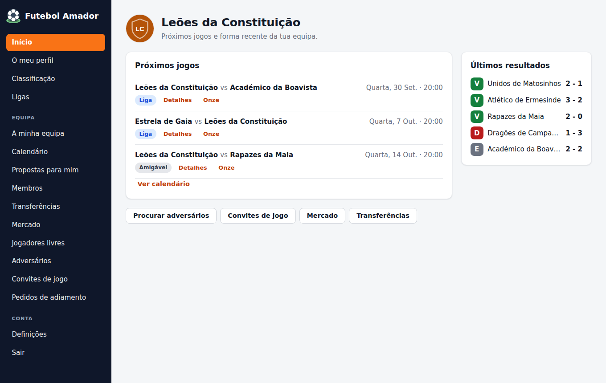
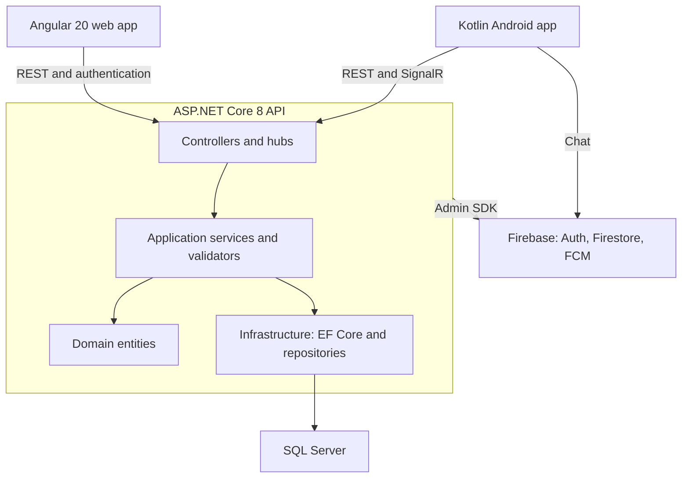

# Futebol Amador — Amateur Football Platform

A full-stack platform for organising amateur football: teams, leagues with promotion and relegation, transfers, match invitations, calendars, starting lineups, and player statistics. An ASP.NET Core API serves an Angular web frontend and a Kotlin Android app, sharing the same database and Firebase project.

A group project for **Software Development Laboratory**, in the third year of the BSc in Computer Engineering at ESTG – Polytechnic of Porto (2025/26), reviewed in 2026. The Android app was developed in parallel for Mobile and Ubiquitous Computing.

[](https://github.com/fmpoliveira05-jpg/futebol-amador/actions/workflows/backend.yml)
[](https://github.com/fmpoliveira05-jpg/futebol-amador/actions/workflows/web.yml)
[](https://github.com/fmpoliveira05-jpg/futebol-amador/actions/workflows/android.yml)

**Try it without installation:** [web demo](https://fmpoliveira05-jpg.github.io/futebol-amador/) using fictional in-memory data. Any email and password work in demo mode.



## Team

| Contributor | Area | GitHub |
|---|---|---|
| Artur Pinto | Backend and Android | |
| Willkie Filho | Backend and Android | |
| Ian Costa | Backend and web frontend | |
| Francisco Oliveira | Backend and web frontend | [@fmpoliveira05-jpg](https://github.com/fmpoliveira05-jpg) |

The three original repositories (backend, web, and Android) were merged with their complete histories, preserving individual contributions.

**My contribution:**

- **Backend:** team membership requests and search filters; authentication (login, logout, and password changes); overall standings; many of the service unit tests for teams, matches, and invitations.
- **Web frontend:** login and registration; player profiles and membership requests; free-agent listings; match calendar and cancellation; Compodoc documentation.
- **2026 review:** merged the repositories and removed secrets from history; fixed the security and correctness issues below; rebuilt the web interface with demo mode and tests; enabled backend integration tests in CI.

Artur and Willkie developed most of the Android app. During the review, I fixed bugs and subsequently added league, transfer, and lineup screens.

## Features

- **Teams:** any player can create a team and its home ground, becoming an administrator. Teams can have up to four administrators, who manage join requests, invite free agents, promote members, and remove members.
- **Friendlies:** search opponents by division, city, points, average age, or squad size; propose a date and ground; accept, decline, or counteroffer. Scheduled matches can be postponed by agreement or cancelled with a reason.
- **Leagues:** teams register before a season; a double round-robin schedule alternates home and away matches. League games award points; friendlies do not. Standings show played, won, drawn, lost, goals for/against, goal difference, points (3/1/0), and last-five-match form. At the configured season end, the champion receives a trophy and teams are promoted or relegated. League games can be rescheduled by agreement; cancellation requires a replacement date.
- **Transfers without money:** list a player on the market or submit an offer; moves require club and player approval. Filters include team, league, nationality, and position, with free agents included.
- **Starting lineups:** select formation, position-filtered starters, and substitutes until two hours before kickoff. Missing lineups are generated automatically.
- **Results:** both team administrators submit scores in real time using SignalR; the match finishes only when scores agree. Each team records its own fouls, goals and assists, cards, and substitutions, producing a match report and minutes played.
- **Player profiles:** preferred foot, weight, status, nationality, current club and joining date, season-by-season appearances/goals/assists/minutes/cards, and transfer history.
- **Principal administrator:** only the team creator can demote other administrators; the creator cannot be demoted.
- **Calendar:** monthly grid with holidays and indicators for match type and status; day details include postponement and cancellation reasons.
- **Real time:** match chat through Firestore, push notifications through Firebase Cloud Messaging, and SignalR hubs for starting and finishing matches.

## Architecture



- **Backend:** Clean Architecture with `Domain` (entities/rules), `Application` (services, validators, repository interfaces), `Infrastructure` (EF Core and SQL Server), and `Api` (REST controllers, SignalR hubs, background services).
- **Authentication:** Firebase Authentication. The API validates Firebase ID tokens as JWTs; the Firebase UID identifies the player in the database. Web sessions use API-issued HttpOnly cookies; Android uses tokens.
- **Web:** zoneless Angular 20, standalone components, signals, lazy-loaded routes, functional interceptor and guard.
- **Android:** Kotlin, Jetpack Compose, MVVM, Hilt, Retrofit, Room for local sessions, and SignalR.

## Structure

```text
backend/   ASP.NET Core 8 API and NUnit unit/integration tests
web/       Angular 20 frontend and Jasmine/Karma/Playwright tests
mobile/    Kotlin/Jetpack Compose Android app
docs/      Security, GDPR, operations, costs, screenshots, and league design
operacao/  SQL Server backup/restore and Firestore export with restore tests
firebase/  Firestore rules and emulator configuration
```

Each application folder has its own README with setup instructions.

## Run locally

**Frontend with sample data** (Node.js 20+):

```bash
cd web
npm ci
npm run demo        # http://localhost:4200
```

**Complete system:** requires SQL Server and a Firebase project. Follow the [backend](backend/README.md), [web](web/README.md), and [Android](mobile/README.md) instructions.

**Tests:** run the following from the repository root. These examples use Bash syntax; `./gradlew` becomes `gradlew.bat` in Windows terminals.

```bash
(cd backend && dotnet test)  # In-memory integration tests, no Firebase credentials
(cd backend && FA_TESTES_SQLSERVER="Server=localhost,1433;User Id=sa;Password=...;TrustServerCertificate=True" \
  dotnet test --filter Category=SqlServer)
(cd firebase && firebase emulators:exec --only firestore --project demo-futebol-amador \
  "dotnet test ../backend/Tests --filter Category=Firestore")
(cd web && npm run test:ci && npx playwright test)
(cd mobile && ./gradlew testDebugUnitTest)
./operacao/sqlserver/testar-restauro.sh
```

## Changes in the 2026 review

### Repository

- Merged all three repositories while preserving each author's history.
- Removed database passwords, Firebase keys, test tokens, Cypress credentials, and generated folders (`bin/`, `obj/`, `node_modules/`, coverage reports) from history.
- Added a workflow per application folder, triggered by relevant changes. Backend integration and web tests require no secrets.

### Backend security fixes

- Authenticated users could edit another player's profile because the player ID came from the request body.
- Membership requests had commented-out administrator checks; one team's administrator could accept another team's requests; players could approve their own requests.
- Unauthenticated users could create a super administrator.
- Email, phone, and address were exposed in profiles and member lists. They are now restricted to the player and teammates.
- Password changes used `GET` with passwords in the URL.
- `GlobalExceptionHandler` was never reached. Business errors returned HTTP 500 with internal messages; they now map to 400/401/403/404, and unexpected errors hide internal details.

### September 2026 security review

Added rate limiting, mandatory email verification, web HttpOnly session cookies and CSRF protection, logout revocation, API/web security headers, Turnstile, API-signed Cloudinary uploads, versioned Firestore rules, reduced personal-data exposure, encrypted Android sessions, and release-build shrinking. Configuration and remaining risks are documented in [docs/SEGURANCA.md](docs/SEGURANCA.md).

### Production-related improvements recorded in September 2026

- **Errors:** web 404/error pages; Portuguese ProblemDetails for API 404/405/409/413/503 responses.
- **Timeouts and resilience:** 15-second web timeout, one retry only for GET, Android OkHttp limits, Polly for external services, and Kestrel/SQL limits.
- **Duplicates and concurrency:** `Idempotency-Key`, disabled buttons during requests, unique constraints, and `rowversion`. A real SQL Server test confirms four simultaneous invitation acceptances create one match.
- **Performance:** pagination, indexes, removal of N+1 queries, public-query caching. Recorded load test: 100 virtual users, p95 137 ms, zero errors.
- **Monitoring and backups:** `/health/live`, `/health/ready`, `uptime.yml`, tested SQL Server backup/restore scripts, and Firestore export tested with the emulator.
- **GDPR:** privacy policy, registration acceptance, account export/deletion on web and Android, automatic retention, essential-only cookies, and browser-storage tests.
- **Quotas and costs:** per-user limits on expensive operations and a budgeting guide.

See [operations](docs/OPERACAO.md), [GDPR](docs/RGPD.md), and [costs](docs/CUSTOS.md) documentation. These describe implemented controls and recorded tests; they are not a guarantee of production readiness in every deployment.

### Correctness fixes

- **Backend:** competitive matchmaking calculated hours backwards, failed to save matches or remove queued teams, and crashed at lower divisions. Rejecting postponement cancelled a match. Completed matches could finish twice and award duplicate points; friendlies also awarded points. Other fixes addressed ages reported in days, member-list crashes, notification-hub startup, and chat being lost when creating a match.
- **Web:** team search used a nonexistent endpoint, membership requests had an incorrect payload, development builds used production configuration, sessions did not expire, position `0` (forward) was treated as missing, and screens failed to update because zoneless state was not held in signals.
- **Android:** invitation submission navigated to a nonexistent route; reversed position ordering registered forwards as goalkeepers; registration errors were ignored; the API address was a temporary ngrok tunnel.

### Web frontend

- Rebuilt the interface with shared styles, role-dependent mobile navigation, upcoming matches/recent form, and standings, postponement, and password-change pages.
- Added **demo mode** using an in-memory API interceptor, also used by end-to-end tests and GitHub Pages.
- Initially added 50 Jasmine/Karma unit tests and nine Playwright end-to-end scenarios on desktop/mobile, replacing Cypress tests tied to the production API.

### Leagues, transfers, and lineups

Added after the review across the API, web, and Android. Decisions and API contracts are in [docs/novas-funcionalidades.md](docs/novas-funcionalidades.md).

- Leagues replace divisions and competitive matchmaking; its queue and hub were removed.
- `LigasTransferenciasEOnzes` only adds tables and columns. At startup, existing teams are assigned to leagues based on their old divisions.
- Recorded test counts after these additions: backend 407 passing and three skipped; web 63 unit tests and 12 end-to-end scenarios; Android JUnit tests for calendar, lineup, and event logic.

## Known limitations

- Running the complete system requires your own Firebase project (Authentication, Firestore, Cloud Messaging) and SQL Server. Without them, use the frontend demo.
- Android reads local session data on the main thread through `allowMainThreadQueries` for synchronous interceptors.
- Android unit tests cover position contracts and league/calendar/lineup/event logic, not screens. Instrumented tests require an emulator and do not run in CI.
- New Android league, market, lineup, report, and player-profile screens use Portuguese text even on English-language devices.
- Each team records its own match events without opponent confirmation; only the final score requires agreement.
- Android has no Turnstile or App Check; requests without `Origin` rely on rate limiting. See [security documentation](docs/SEGURANCA.md).