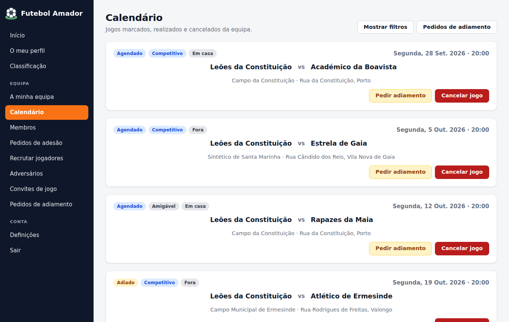

# Futebol Amador — Web Frontend

Angular 20 frontend for Futebol Amador. See the [main README](../README.md) for the project overview.



## Try it locally

```bash
npm ci
npm run demo      # http://localhost:4200
```

**Demo mode** needs no backend:

- `demoInterceptor` responds with in-memory data: two Greater Porto leagues with eight teams, an active season, matches with lineups/events, transfer offers, invitations, and membership requests.
- Any email and password sign in as an administrator of “Leões da Constituição”.
- Changes are saved in the tab's `sessionStorage`.

The same version is published on GitHub Pages.

To use the local API at `http://localhost:5218`, follow the [backend README](../backend/README.md), then run:

```bash
npm start
```

## Pages and permissions

| User | Available actions |
|---|---|
| Visitor | Landing page, league standings and fixtures, registration, login |
| Player without a team | Search teams, request membership, respond to invitations, create a team |
| Team member | Upcoming matches/recent form, team profile and trophies, monthly calendar, match reports, player statistics, personal transfer offers |
| Administrator | Edit/delete team, manage members, transfer market, free agents, opponent search, invitations, lineups, scores/events, postponement/cancellation, league registration |

Only the principal administrator can demote other administrators. League, transfer, lineup, and statistics details are in [docs/novas-funcionalidades.md](../docs/novas-funcionalidades.md). Super administrators manage leagues and seasons (creation, scheduling, closing) through the API; the web frontend has no management pages for these operations.

The sidebar adapts to the user's role. `authGuard` protects routes using `requiresTeam`, `requiresNoTeam`, and `isAdmin`; administrator privileges are also checked by the API.

## Code organisation

```text
src/app/
  core/interceptors/     Authentication and request handling; 401 ends the session
  core/demo/             Demo interceptor and data
  services/              One service per API resource
  shared/auth/           Functional authGuard
  shared/http/           Query filters and API error messages
  shared/Dtos/           Request and response models
  components/pages/      Lazy-loaded pages
  components/partials/   Navigation, team search/forms, lineup pitch
  shared/calendario/     National holidays and month grid
  shared/competicao/     Form, standings zones, position-based player selection
```

Design decisions:

- **Zoneless:** component state uses signals; no zone.js.
- **Standalone components:** `@if`/`@for` control flow and route parameters exposed through `input()` with `withComponentInputBinding`.
- **Cookie sessions:** `SameSite=Strict` and `Secure` over HTTPS. `AuthService` exposes session state as a signal; `isAuthenticated()` checks expiry.
- **Error handling:** `mensagemDeErro` converts ProblemDetails, ASP.NET validation errors, and connection failures into user-facing messages.
- **Team badges:** resized to 256×256 in the browser before upload.
- **Lazy loading:** all pages are loaded on demand; the recorded initial bundle is approximately 340 kB (96 kB compressed).

## Tests

```bash
npm run test:ci       # 63 Jasmine/Karma unit tests, headless Chrome, coverage
npx playwright test   # 12 demo end-to-end scenarios on desktop/mobile, plus storage checks
```

Unit tests cover session/expiry, interceptor/guard, membership-request payloads, HTTP/image utilities, calendar ordering and movable holidays, monthly grids, form/standings zones, lineups, registration minimum age, and demo mode.

End-to-end scenarios exercise login and intended-route return, membership approval, match invitations, postponement acceptance, calendar navigation, standings, transfer offers, match scores/events, and logout. Portuguese standings abbreviations correspond to played, wins, draws, losses, goals for, goals against, goal difference, and points.

README screenshots are generated with Playwright:

```bash
CAPTURAS=1 npx playwright test capturas --project=desktop
```

## Build

```bash
npm run build       # Production, src/app/environments/environment.ts
npm run build:demo  # Demo build
```

Production API configuration is in `environment.ts`; `environment.development.ts` uses `http://localhost:5218/api`.

The API sets `HttpOnly` session cookies, so JavaScript cannot read tokens. Requests use `withCredentials` and `X-Requested-With: FutebolAmador`. Set `turnstileSiteKey` for Cloudflare Turnstile; an empty value disables it. `deploy/nginx.conf` provides security headers and CSP; GitHub Pages uses a CSP meta tag in `src/index.demo.html`. See [security documentation](../docs/SEGURANCA.md).

## Production-related controls

- **Requests:** 15-second timeout, a specific timeout message, and one retry only for GET network failures (`core/interceptors/pedidos.interceptor.ts`). `Idempotency-Key` for team, invitation, membership-request, and offer creation; buttons disabled during submission.
- **Errors:** 404 catch-all route `**` and `/erro` for a failed application-chunk load, often following a deployment.
- **GDPR:** `/privacidade` linked from footer/registration, mandatory policy acceptance, and data download/account deletion in settings. Privacy contact is `contactoPrivacidade` in `environment*.ts`.
- **Source maps:** disabled in production/demo; nginx rejects `*.map`.
- **Browser storage:** Playwright's `armazenamento` project uses the production build with `e2e` configuration and a simulated API. It checks that storage has no tokens/personal data, cookies are `HttpOnly`, `Secure`, and `SameSite=Strict`, and logout removes them.

```bash
npx playwright test
npx playwright test --project=armazenamento
```